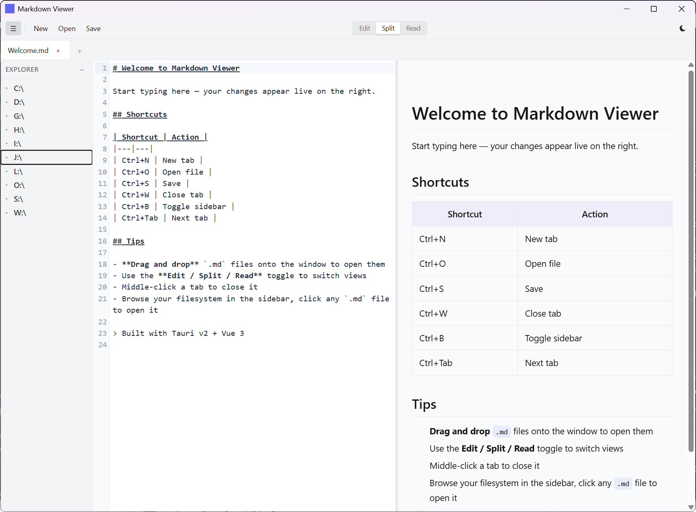

# Markdown Viewer

A lightweight, cross-platform markdown viewer/editor that registers as the default app for `.md` files. Built with **Tauri v2 + Vue 3 + TypeScript**.

**Windows setup is a 4 MB download and about 13.1 MB installed. ~25 MB RAM. Native feel.**



## Features

- Split-pane editor + live preview (Edit / Split / Read modes)
- Tabbed editing with multiple files
- Filesystem sidebar with lazy-loaded tree navigation
- Drag-and-drop `.md` files to open
- Dark / light theme
- Registers as default `.md` file handler on Windows
- Keyboard shortcuts: Ctrl+N/O/S/W/B/Tab
- About dialog with version, update check, and in-app install

## Stack

| Layer | Technology |
|-------|-----------|
| Shell | [Tauri v2](https://v2.tauri.app/) (Rust) |
| Frontend | Vue 3 + Composition API |
| Editor | CodeMirror 6 |
| Markdown | markdown-it |
| Styling | Tailwind CSS v4 |
| Build | Vite |

## Prerequisites

- [Rust](https://rustup.rs/) (stable)
- [Node.js](https://nodejs.org/) (18+)
- [pnpm](https://pnpm.io/) (`npm install -g pnpm`)

## Development

```bash
pnpm install
pnpm tauri dev
```

## Build

```bash
pnpm tauri build
```

Produces installers in `src-tauri/target/release/bundle/`. Measured download sizes:

| Package | Size |
|---|---|
| Windows NSIS setup | 4.4 MB download, about 13.1 MB installed |
| Windows MSI | 5.6 MB |
| macOS Apple Silicon DMG | 3.7 MB |
| macOS Intel DMG | 3.8 MB |
| Linux `.deb` | 4.9 MB |
| Linux `.rpm` | 4.9 MB |
| Linux AppImage | 79.5 MB |

## Install

The installers register Markdown Viewer as an application that can open Markdown files. Your operating system keeps control of the default, so select Markdown Viewer once after installation:

- **Windows:** Run the NSIS installer, then right-click an `.md` file → **Open with** → **Markdown Viewer** → **Always use this app**.
- **macOS:** Move the app to Applications, then select an `.md` file → **Get Info** → **Open with** → **Markdown Viewer** → **Change All**.
- **Ubuntu/Debian:** Install the `.deb`, then right-click an `.md` file → **Open With** → **Markdown Viewer** and set it as the default.
- **Fedora/RHEL:** Install the `.rpm`, then choose Markdown Viewer from the file manager's **Open With** settings.

The Linux AppImage is portable and does not install desktop file associations by itself.

## Updates

The Help menu holds About and an opt-in **Add "New Markdown" to right-click menu** item. On Windows it adds **New → Markdown Document** to Explorer for the current user, and uninstalling the app removes it. On Linux it adds `Markdown Document.md` to your Templates folder, plus a KDE template entry under KDE. Choose it again to remove the entry. The item is hidden on macOS. After startup the app checks in the background and opens About when a newer published release exists. Update downloads and installs the new version for every package: the Windows setup `.exe` and `.msi`, the macOS app, and the Linux AppImage, `.deb`, and `.rpm`. Linux `.deb` and `.rpm` installs ask for your password to install the package.

Release drafts are not visible to the updater until they are published. Signing uses the GitHub Actions secret `TAURI_SIGNING_PRIVATE_KEY`. That private key is not in the repo. An install from before this release has no updater, so the first signed release is installed by hand.

## Roadmap

See [docs/PLAN.md](docs/PLAN.md) for the full roadmap including universal file editing, terminal integration, and agent/memory workspace.

## License

Private.
